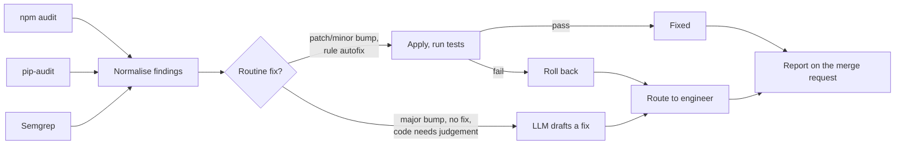

# PatchPilot

PatchPilot reads the reports your security scanners already produce, fixes the routine findings itself, checks that your tests still pass, and hands everything else to an engineer with a clear reason and, for code issues, an LLM-drafted fix.

Most findings that block a merge are boring: a dependency one patch version behind, a rule that ships its own autofix. Engineers still spend time on them, and the risky findings get lost in the noise. PatchPilot clears the boring ones and makes the risky ones easy to act on.

```
$ patchpilot --repo . --npm-audit npm-audit.json --pip-audit pip-audit.json \
             --semgrep semgrep.json --test-cmd "pytest -q"

5 of 7 findings fixed automatically; 2 need an engineer.
```

## What it does



| Finding | What PatchPilot does |
|---|---|
| Direct dependency with a patch or minor fix (npm, pip) | Bumps it in `package.json` or `requirements.txt`, keeping your `^`/`~` style and comments |
| Semgrep finding whose rule ships an autofix | Applies the rule's exact replacement using the reported byte offsets |
| Fix needs a major version upgrade | Routes it: breaking changes need a person |
| Transitive dependency, or no fixed version yet | Routes it with the reason |
| Code finding with no autofix | Asks Claude for a minimal fix, attaches it to the report for review |

Every applied change is tested on its own when you pass `--test-cmd`. If the tests fail, that one change is rolled back and routed, so a bad bump never sneaks through.

LLM fixes are drafts by default. With `--apply-llm` PatchPilot writes a fix to disk only when the model reports high confidence and the tests still pass.

## Example report

Running against [`examples/demo-app`](examples/demo-app), a deliberately vulnerable app:

> **5 of 7** findings fixed automatically; **2** need an engineer.
>
> | Severity | Finding | Where | Change |
> |---|---|---|---|
> | critical | Prototype Pollution in minimist | `minimist <1.2.6` | Bumped minimist from ~1.2.5 to ~1.2.6 in devDependencies. Tests pass. |
> | high | Command Injection in lodash | `lodash <=4.17.20` | Bumped lodash from ^4.17.15 to ^4.17.21 in dependencies. Tests pass. |
> | high | YAML deserialization (`yaml.load`) | `app.py:8` | Applied the rule's autofix at app.py:8. Tests pass. |
>
> **Needs an engineer**
> - moderate · jsonwebtoken signature validation bypass · fix needs a major upgrade to 9.0.0; check for breaking changes.
> - medium · Formatted SQL query · `app.py:13` · LLM draft attached for review.

The scanner reports in `examples/demo-app/reports` are hand-written samples modelled on real advisories, so the demo runs without installing npm, pip-audit or Semgrep.

## Quick start

```bash
pip install -e ".[llm,dev]"
pytest -q

# Try it on the demo app (dry run changes nothing)
patchpilot --repo examples/demo-app --dry-run \
  --npm-audit examples/demo-app/reports/npm-audit.json \
  --pip-audit examples/demo-app/reports/pip-audit.json \
  --semgrep examples/demo-app/reports/semgrep.json
```

To draft fixes for code findings, set `ANTHROPIC_API_KEY` and add `--llm`. The model defaults to `claude-sonnet-5-5`; override it with `PATCHPILOT_MODEL`.

## In a GitLab merge-request pipeline

`.gitlab-ci.yml` includes a `patchpilot-demo` job. In your own project, generate the reports in earlier jobs, then:

```yaml
patchpilot:
  stage: security
  rules:
    - if: $CI_PIPELINE_SOURCE == "merge_request_event"
  script:
    - pip install "patchpilot[llm] @ git+https://github.com/<you>/patchpilot"
    - patchpilot --npm-audit npm-audit.json --semgrep semgrep.json --test-cmd "npm test" --llm --post-note --fail-on high
```

`--post-note` posts the report on the merge request. It needs a project access token with the `api` scope saved as the CI variable `PATCHPILOT_GITLAB_TOKEN`. `--fail-on high` fails the job when a high or critical finding is left for an engineer.

## Options

| Flag | Meaning |
|---|---|
| `--repo PATH` | Repository root (default `.`) |
| `--npm-audit`, `--pip-audit`, `--semgrep` | Scanner reports to read; give at least one |
| `--test-cmd CMD` | Command that must still pass after each change |
| `--llm` | Draft fixes for code findings with Claude |
| `--apply-llm` | Write high-confidence LLM fixes to disk (still tested) |
| `--dry-run` | Report what would change without touching files |
| `--report`, `--json` | Where to write the Markdown and JSON reports |
| `--post-note` | Post the report on the GitLab merge request |
| `--fail-on SEVERITY` | Exit 1 if a finding at or above this severity is left unfixed |

## Design choices

- **Deterministic first.** Version bumps and published autofixes are applied by plain code. The LLM only sees findings that need judgement, which keeps cost low and behaviour predictable.
- **Never guess on breaking changes.** Major upgrades, transitive dependencies and findings without a published fix are always routed to a person.
- **Every change is tested alone.** A failing change is rolled back without affecting the others.
- **The LLM sees only what it needs.** A window of lines around the finding, never the whole repository, and it must answer in a fixed JSON shape that is validated before use.
- **No runtime dependencies.** The core is the Python standard library; the Anthropic SDK is optional.

## Project layout

```
src/patchpilot/
  findings.py   parse npm audit, pip-audit and Semgrep into one Finding type
  fixers.py     deterministic fixers and rollback
  llm.py        prompt, JSON contract and Anthropic client for drafted fixes
  pipeline.py   fix -> test -> route loop
  report.py     merge-request comment and JSON output
  gitlab.py     post the report on the merge request
  cli.py        command-line interface
tests/          23 tests covering parsing, fixers, rollback, LLM handling and GitLab posting
```

## Background

I built an internal agent like this at work to clear security findings flagged at merge time. PatchPilot is an independent, from-scratch open-source version of the idea. It contains no employer code or data.

## License

MIT
